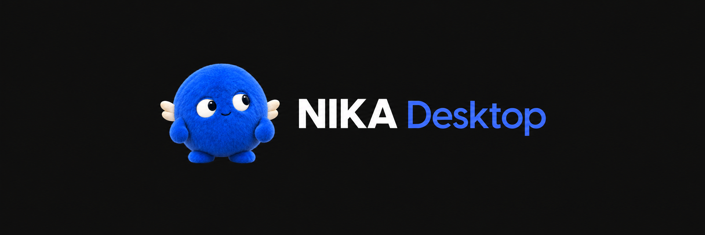
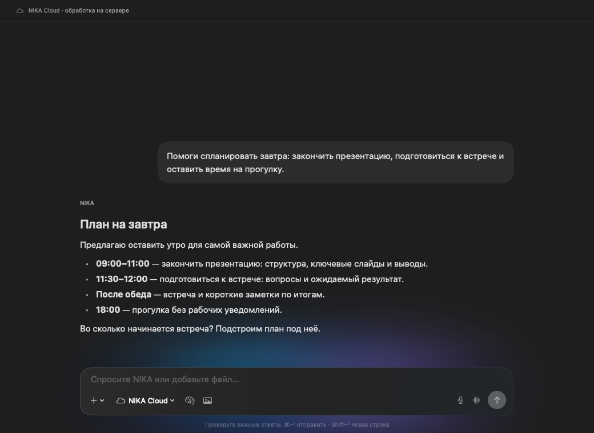
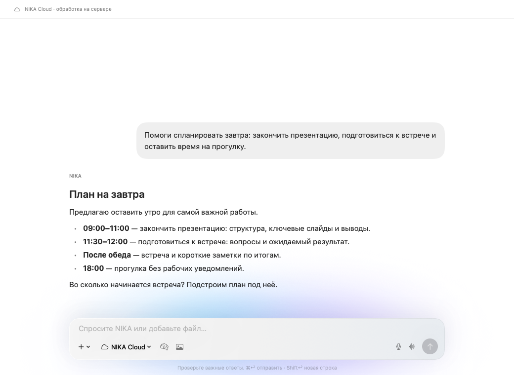
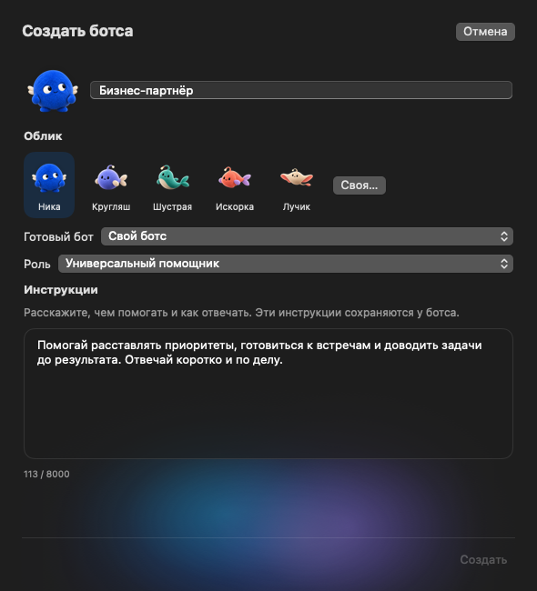
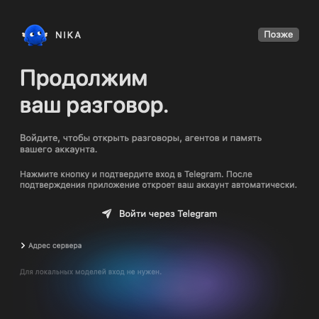
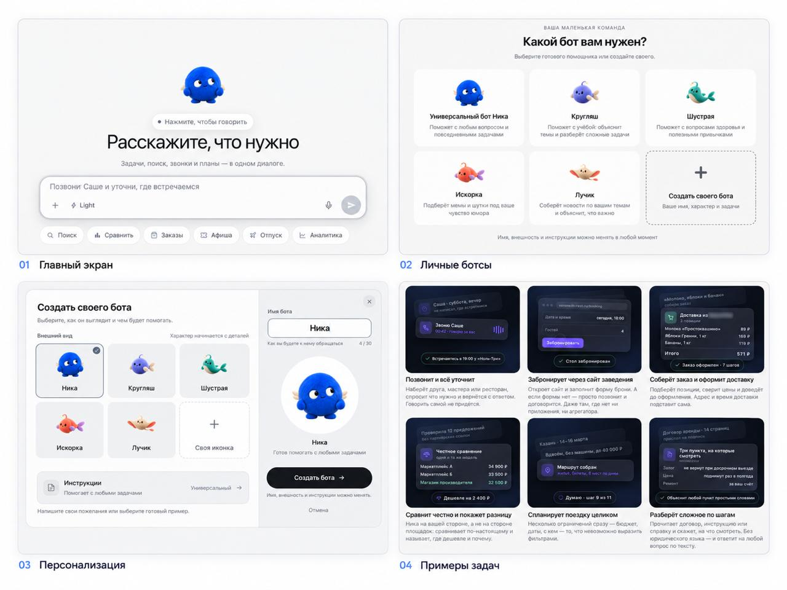

# NIKA — Native AI Assistant for Mac with Local LLMs

**English** · [Русский](README.ru.md)



**Your AI assistant, running on your Mac.** Download a local model, chat offline, and work with your documents. Built with SwiftUI and llama.cpp — ready to explore, customize, and extend.

[](https://github.com/1nikitas/NIKA_desktop/stargazers)
[](https://github.com/1nikitas/NIKA_desktop/forks)


[Quick start](#quick-start) · [Local features](#what-runs-on-your-mac) · [Models](#local-models) · [Benchmarks](#benchmarks) · [Development](docs/DEVELOPMENT.en.md) · [Issues](https://github.com/1nikitas/NIKA_desktop/issues)



<sub>Actual SwiftUI interface with a demonstration conversation. The app interface is currently in Russian.</sub>

## Quick start

**Requires:** an Apple Silicon Mac, macOS 26+, Xcode 16.4+ with Swift 6, Python 3, and Homebrew.

```bash
brew install llama.cpp
git clone https://github.com/1nikitas/NIKA_desktop.git
cd NIKA_desktop
bash scripts/dev.sh
```

Open **Локальные модели** (Local models), download **NIKA Smart**, then choose **Начать разговор** (Start conversation). **No account is required for local chat.** The first build downloads WebRTC; model downloads are separate. Once a model is installed, local chat works offline.

This is a source build with an ad-hoc signature. A notarized release is not currently provided. [Full setup and development guide →](docs/DEVELOPMENT.en.md)

## What runs on your Mac

- **Local LLMs:** download a model or import a compatible GGUF and run it through llama.cpp.
- **Document chat:** attach text documents and PDFs with extractable text. Image input requires a compatible vision projector.
- **Local history and memory:** keep local conversations on your Mac. A local model error never silently sends the request to the cloud.
- **Native macOS interface:** SwiftUI, multiple windows, a menu bar entry, keyboard shortcuts, and light and dark themes.
- **Mac integrations:** calendar and reminders, with confirmation before proposed local actions execute.

## Optional NIKA cloud

Sign in through Telegram to access NIKA account conversations, cloud agents, tools, integrations, and custom assistants with their own instructions and materials. Live cloud voice uses WebRTC. These features require an account and an internet connection.

**This repository contains the desktop client. The NIKA cloud backend is not included.** You can build and modify the local client without running that backend.

<details>
<summary><strong>More screenshots: light theme, custom assistants, sign-in</strong></summary>



| Cloud assistant editor | Telegram sign-in |
| --- | --- |
|  |  |

</details>

## Local models

| Model | Parameters | Quantization | File size |
| --- | ---: | --- | ---: |
| NIKA Mini (Qwen3.5-0.8B)¹ | 0.8B | Q8_0 | 812 MB |
| NIKA Balance (Qwen3.5-2B) | 2B | Q5_K_M | 1.44 GB |
| **NIKA Smart (Qwen3.5-4B)** | **4B** | **Q4_K_M** | **2.74 GB** |
| NIKA Quality (Qwen3.5-4B) | 4B | Q5_K_M | 3.14 GB |
| Your own compatible GGUF | Model-dependent | Your choice | Depends on model and quantization |

Other GGUF options include [Gemma 4 12B](https://huggingface.co/google/gemma-4-12B-it-qat-q4_0-gguf), [Qwen3.5-9B](https://huggingface.co/bartowski/Qwen_Qwen3.5-9B-GGUF), and [gpt-oss-20b](https://huggingface.co/ggml-org/gpt-oss-20b-GGUF). These imports need enough memory and support in your installed llama.cpp version. They have not been tested in NIKA and are not recommendations for an 8 GB Mac.

For an **8 GB Mac**, start with **Smart** and a 4096-token context; image input adds a 0.67 GB projector and needs a **2048-token context**. Quality targets 16 GB or more; Balance uses less memory. The memory estimate reserves room for macOS, but **physical 8 GB hardware has not yet been tested**.

¹ Mini is retained for existing installations and conversations. New installations offer Smart, Quality, and Balance.

## Benchmarks

### Local engine speed

<!-- LOCAL-BENCHMARK:START -->
**Qwen3.5 4B Q4_K_M · Apple M4 Pro · 24 GB · Metal**

Measured October 13, 2026, with five repetitions after warm-up, llama.cpp `7fe450e19`.

| Workload | Mean throughput | Standard deviation |
| --- | ---: | ---: |
| Prompt processing · pp512 | **611.60 tokens/s** | ±0.72 |
| Token generation · tg128 | **57.50 tokens/s** | ±0.46 |

These results describe this 24 GB M4 Pro. Speed on an 8 GB Mac has not been measured.
<!-- LOCAL-BENCHMARK:END -->

This measures llama.cpp throughput with synthetic tokens, not app response latency, time to first token, or answer quality. [Raw results](docs/benchmarks/m4-pro-24gb-qwen35-4b-q4/raw.json) · [Environment](docs/benchmarks/m4-pro-24gb-qwen35-4b-q4/environment.json) · [Method and reproduction instructions (Russian)](docs/BENCHMARKS.md).

### Base model quality

| Benchmark | Qwen3.5 4B |
| --- | ---: |
| MMLU-Pro | 79.1 |
| GPQA Diamond | 76.2 |
| IFEval | 89.8 |

Published results from the [official Qwen model card](https://huggingface.co/Qwen/Qwen3.5-4B#benchmark-results), **not NIKA or Q4_K_M evaluations**. Quantization, context, and generation settings can change results.

## Keyboard shortcuts

| Action | Shortcut |
| --- | --- |
| New conversation / new window | `⌘N` / `⌘⇧N` |
| Send / stop | `⌘↩` / `⌘.` |
| Models / voice | `⌘⇧M` / `⌘⇧V` |
| Quick access | `⌃⌥Space` |
| Settings | `⌘,` |

## Build on NIKA

Open `Package.swift` in Xcode. The repository is self-contained: you do not need the iPhone repository. The interface uses SwiftUI, local inference uses llama.cpp, and live cloud voice uses WebRTC.

- [Setup, architecture, and tests](docs/DEVELOPMENT.en.md)
- [Report a bug](https://github.com/1nikitas/NIKA_desktop/issues/new): include reproduction steps, your macOS version, and Mac model.
- [Propose a change](https://github.com/1nikitas/NIKA_desktop/pulls): keep the PR focused and explain the behavior and how you tested it.

If NIKA is useful to you, star the repository to follow it or fork it to experiment with your own assistant.

Thanks to [Qwen](https://huggingface.co/Qwen), [llama.cpp](https://github.com/ggml-org/llama.cpp), and [WebRTC for macOS](https://github.com/stasel/WebRTC).

<details open>
<summary><strong>Prefer to skip installation? NIKA is already available on the web</strong></summary>

Open [NIKA on the web](https://nika-agent.ru/) for a ready-to-use assistant. Sign in without installing the desktop app or downloading models. The hosted service connects cloud LLMs, the agent runtime, and tools.

NIKA is also available through its [Telegram bot](https://t.me/nika_ai_2_bot).

The screenshot below shows the web interface. Start by messaging a personal assistant, then customize its name, appearance, and instructions.



Choose the desktop client for local inference, source code access, and experimentation. Choose the web version to start with a hosted service.

</details>
